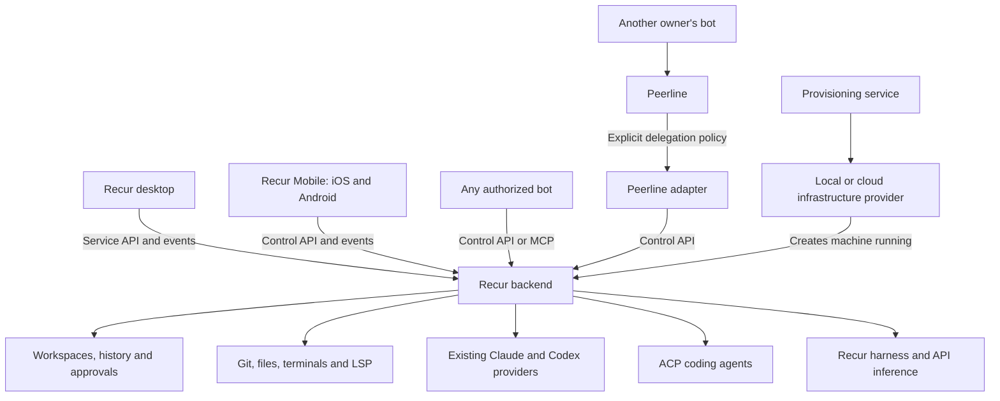

# Recur backend: desktop, mobile, bots and remote workspaces

**Status:** Design proposal. No runtime changes implemented.

## Summary

Recur becomes a coding backend that users own and can access from the desktop,
from Recur Mobile on iOS and Android, or from any authorized bot. The same backend
runs locally, on an existing remote machine, or on a machine created by a
provisioning service.

A user can tell their bot, “Use my Recur backend to implement this change.” The
bot delegates the task and follows its progress. Recur executes the work using
an agent configured on that machine. The user can open the desktop or mobile app at any time
to inspect changes, answer questions, steer the agent or stop the run.

Local and remote deployments have the same capabilities. Users can install and
log into supported agents such as Claude Code or Codex on either machine, or
configure API-key inference for Recur's own harness. Availability depends on
what is installed and configured on the backend host.

The design decision this document asks for is the backend extraction and the
remote task workflow (delivery steps 1 to 3). Bot control, remote desktop,
mobile, Peerline and provisioning are described here so the API does not
preclude them, but each is its own project and gets its own detailed design
before it starts. ACP support is independent of this plan and is covered only
to show where it fits.

## Architecture

| Component | Responsibility |
|---|---|
| Desktop | Display workspaces, conversations, diffs, files and terminals; provide human control |
| Recur Mobile (iOS and Android) | Connect to backends, delegate tasks, follow progress, review changes and provide human control |
| Backend | Own workspace state, agent execution, tools, credentials, approvals and history |
| Control API | Let authorized clients delegate, inspect, steer and cancel work |
| MCP adapter | Expose control operations as tools for compatible bots |
| ACP provider | Connect the backend to coding agents that speak ACP |
| Peerline adapter | Accept explicitly permitted delegation between separately owned bots |
| Provisioning service | Create and manage machines through infrastructure provider adapters |

The controller and coding agent are independent choices. A bot using one model
can delegate coding to an agent using another. Recur does not need a dedicated
integration for each bot brand.

## Backend ownership and deployment

Each backend owns its database, workspace files, running agents and credentials.
The desktop connects to it rather than opening its database or accessing its
filesystem directly. SQLite is not shared between machines.

Support three deployment paths:

1. **Local:** run the backend inside the desktop process. The in-process
   `Services` implementation is the local backend; it keeps direct database and
   filesystem access and never goes through a loopback network hop. Remote
   backends are reached through proxies that implement the same service traits,
   so the desktop has one code path above the service boundary.
2. **Existing remote machine:** connect to a supported machine the user can
   access. Users manage installed agents and authenticate on that machine.
3. **Provisioned machine:** create a host through the provisioning service,
   then connect to the same backend software.

Desktop and mobile clients can save backend connections and select one active
backend at a time. Switching backends keeps identities, caches and credentials
separate. Combining several backends into one view is a later capability.
Desktop dialogs, browser opening, notifications and updates remain local;
workspace files, agent processes and language servers belong on the backend.
Focus and selection are per-client state.

A headless backend is not updated by the desktop updater. It ships as its own
binary or package with the same version scheme, and the operator (or the
provisioning service) upgrades it. Clients and backends exchange protocol and
software versions at connection time; a client refuses a backend whose protocol
version it does not support and says which side needs upgrading. Within a
protocol version, additions are backward compatible so a newer desktop can talk
to an older backend.

### Backend identity

Each backend generates a long-lived identity keypair on first start. Its backend
id is derived from its public key. Pairing establishes trust through an
authenticated channel or an independently verified fingerprint, and clients pin
the key. Subsequent connections must prove possession of the private key through
an authenticated handshake bound to the connection; merely returning the pinned
public key is insufficient.

Use one reviewed mechanism for both identity and transport rather than two
layers: the backend's identity key is the key of its self-signed TLS
certificate, pairing pins that certificate, and every connection is TLS with
the pinned certificate as the trust anchor. This gives the possession proof for
free through the TLS handshake. When a backend sits behind an SSH tunnel the
same TLS runs inside the tunnel, so SSH host validation protects the tunnel and
certificate pinning identifies the backend. An operator may front the backend
with a CA-issued certificate for browsers or other clients, but paired Recur
clients still pin the backend certificate.

Unexpected key changes block connection until explicitly verified. Planned key
rotation needs an authenticated transition from the old identity; recovery after
key loss requires explicit re-pairing. Protect private keys in backups and avoid
cloning a backend identity into independently active instances.

## Recur Mobile: iOS and Android

Recur Mobile provides human control of the same backends through iOS and Android
apps. Execution stays on the backend; the phone does not need a coding CLI,
repository checkout or inference credentials. A task started from a bot or the
desktop is the same task shown on mobile.

The first mobile release supports:

- Pairing with a backend and switching between saved connections.
- Browsing projects, workspaces and active tasks.
- Starting tasks with an available agent and model.
- Reading progress, transcripts and file diffs.
- Sending follow-ups, steering supported agents and canceling runs.
- Answering questions and approving or denying actions within the user's authority.

Use the existing control API and reconnect contract, with mobile as another
human client. Each device has a revocable credential stored in platform secure
storage. Pairing uses an authenticated flow with a short-lived, single-use code
or QR payload that includes the backend's public-key fingerprint; it must not
expose a permanent backend credential.

When the app resumes, reload authoritative state and replay available events.
Offline views clearly show stale state. Do not silently queue execution or
approval commands while offline; reconnect and revalidate the target run or
pending request first. Approval responses need a request id and server-side
validation so stale or duplicate answers cannot authorize a different action.

A phone can control a backend on the user's computer only while that computer
and backend are running and reachable. Mobile requires the public endpoint from
delivery step 3 (HTTPS with the pinned backend certificate) or a user-managed
private network such as a VPN or Tailscale; do not assume a desktop SSH tunnel
is available on the phone.

Start with foreground updates. For the publisher-distributed apps, optional push
notifications use publisher-managed APNs and FCM delivery credentials through a
publisher-operated relay. Backends, including self-hosted ones, call it outbound.
Notifications carry only opaque routing ids; opening one fetches details from
the authorized backend. Background suspension must not affect running tasks.
Self-hosted deployments remain fully usable without push. Separately published
apps would need their own delivery configuration.

Full terminal interaction, source editing, provisioning administration and
desktop feature parity are outside the first mobile release. Choose native or
shared mobile UI technology separately; the backend API must not depend on that
choice or on GPUI. Publish an API schema so mobile client bindings can be
generated independently of the UI stack.

## Control from any bot

Expose one versioned control API shared by desktop, mobile and bot adapters.
MCP is the first bot adapter. Bots with HTTP or function-calling integrations
can use the same contract through a thin adapter. The bot product must support
external integrations; a prompt alone cannot grant access to a private backend.

The initial control surface supports:

- Discovering authorized projects, workspaces and available coding agents.
- Starting a task in an authorized workspace, with a permission mode for the
  run chosen from the modes the caller's grants allow.
- Reading run status, transcript and changes.
- Sending a follow-up with live steering or queued delivery.
- Canceling a run.
- Reading pending questions and answering those the caller is permitted to answer.

Task submission returns a run id promptly. Follow-ups return a message id and
an explicit delivery result: started, steered or queued. Use the existing
`ProviderCaps::steer` behavior rather than promising every agent can interrupt
an active turn. Recur's compatible harness already supports steering between
model/tool rounds.

Human and bot commands enter the same ordered execution path and record their
actor. The desktop observes the same run the bot started. Closing either client
does not stop execution; cancellation is an explicit operation. A disconnected
bot can retrieve results later. Unsolicited updates in its chat require a
supported notification or persistent connection mechanism.

### Principals and authorization

Every command records its authenticated principal. Peerline calls additionally
record the mapped peer identity; adapters cannot supply an arbitrary owner id.

| Principal | Credential | Authority |
|---|---|---|
| Owner device (desktop or mobile) | Individually revocable credential issued at pairing | Owner-authorized operations |
| Bot | Scoped bot credential | Explicit backend, project/workspace and operation grants |
| Peerline adapter | Adapter credential and per-peer policy | Intersection of adapter grants and mapped peer policy |
| Agent turn | Existing turn-scoped token | Granted host tools, never controller API access |

Default controller grants are:

| Operation | Owner | Bot | Peerline peer |
|---|---|---|---|
| Discover projects/workspaces/agents | Yes | Scoped | Policy |
| Start task | Yes | Scoped | Policy |
| Read status, transcript, changes | Yes | Scoped | Authorized summaries |
| Follow-up / steer | Yes | Own runs within grants, or explicitly shared runs | Own runs within policy |
| Cancel | Yes | Own runs within grants, or explicitly shared runs | Own runs within policy |
| Answer clarifying question | Yes | If granted | No |
| Approve or deny tool/permission request | Yes | No | No |
| Credential management, merge, delete, permission changes | Yes | No | No |

The Owner column is the backend's owner; a paired desktop or mobile device
inherits the role of the person who paired it. A paired device is not an
administrator by itself, and team roles require explicit grants. Agent-turn
tokens retain existing allowed host tools, including child-workspace creation,
inspection and messaging where granted. They cannot authenticate to the
controller API.

Clarifying answers and permission approvals are distinct operations. Bots cannot
answer a pending permission request by default, and any future automated
approval authority requires explicit per-bot, per-project opt-in.

A bot-started run would otherwise stall at its first permission prompt, which
defeats unattended delegation. So the permission mode is chosen when the task
starts, not answered prompt by prompt. Each bot grant lists the permission modes
the bot may request for a project (for example: ask, accept edits, or full
auto), and the run inherits the mode as it would when started from the desktop.
Prompts that the chosen mode does not cover wait for an authorized human until a
configurable timeout, then deny; whether denial ends the run depends on the
provider. Notifications are sent when configured, even if no human client is
attached. The default grant for a new bot allows the ask mode only, so a bot
gains unattended authority only by an explicit owner choice. Decide the timeout
before bot control ships.

Snapshots, live events, replay and assets enforce the same resource grants as
commands. Filter each delivery for its authenticated recipient. Revocation must
invalidate affected subscriptions and prevent further replay or reads; a scoped
bot never receives another workspace's events through a shared stream.

For remote MCP, distinguish two interoperability paths: manually configured
Recur tokens for clients that support them, and the MCP specification's OAuth
authorization and discovery flow for clients that require it. They are not
interchangeable. Choose and test the first supported client/authentication path
before step 4; broad MCP-client compatibility requires the standard flow.

## ACP and Peerline

### ACP: running coding agents

An ACP provider is another implementation of Recur's existing `Provider`
interface: it translates agent sessions, events, permissions and advertised
capabilities, the same way the Claude and Codex providers do. It needs nothing
from the backend extraction and can ship before it, in the desktop as it is
today. It is not a step of this plan and is tracked separately in
`FOLLOWUPS.md`. OpenCode is a candidate for the first integration.

ACP complements the control API. It does not replace workspace management,
review, terminals or client authorization. Once a backend runs remotely, ACP
agents installed on that host become available there like any other provider.
Negotiate capabilities and pin the supported protocol version; resume, steering
and model selection can differ between agents. This does not require an
immediate rewrite of `ModelRef`.

### Peerline: permissioned delegation between bots

Peerline provides a separate path for bots owned by different people or accounts
to communicate through pairing and grants. An optional adapter maps structured
Peerline task requests to Recur control operations and returns short status or
result messages.

Permission to send a Peerline message does not grant permission to execute code.
The adapter needs an explicit policy mapping peer identity to authorized projects
and operations. Recur enforces execution permissions regardless of message origin.
Keep full transcripts and large diffs in Recur; exchange summaries and authorized
references through Peerline. Direct bot access to Recur remains available without
Peerline.

## Pluggable machine provisioning

Provisioning is a separate service with infrastructure provider adapters.
Proxmox, Hetzner, DigitalOcean, Scaleway, AWS and GCP are candidate providers,
not implemented integrations. Existing-machine registration bypasses provisioning.

Keep three concepts distinct: the infrastructure account creates a machine;
the machine hosts a backend; the backend owns workspaces.

A provisioning request validates ownership and quota, creates the machine,
bootstraps Recur and securely pairs the backend with its owner. Infrastructure
credentials remain in the provisioning service, outside coding machines and
ordinary bot tool access. Accept provider-appropriate credentials or workload
identity rather than requiring a static API key everywhere.

Bootstrap enrollment uses a single-use, short-lived token. Treat cloud-init
user-data and instance metadata as potentially readable by guest processes.
Consume the token before starting coding agents, reject reuse, and restrict
agent access to metadata endpoints where supported. Never place infrastructure
credentials in bootstrap data.

The common lifecycle is deliberately small:

| Operation | Contract |
|---|---|
| List options | Return provider-specific regions, templates and machine options |
| Create | Return an asynchronous operation id and track created resource ids |
| Inspect | Report provisioning progress, machine state and backend readiness |
| Delete | Remove explicitly owned resources according to the requested data-retention policy |

Persist operation state so interrupted setup can reconcile resources without
creating duplicates. Treat machine creation and backend readiness separately.
Advertise optional capabilities such as start/stop, snapshots and resizing;
provider billing and retained-storage behavior remain provider-specific.

For a self-hosted Proxmox deployment, start with one VM per user or trusted team,
with several workspaces inside it. Users can log into that VM and configure their
agents. Per-workspace containers or VMs are a later isolation option. A container
holding a backend and its workspaces is not per-workspace isolation, and mounting
a host Docker socket does not provide a strong host boundary.

Implement one provisioning adapter first. Automatic provider selection, cloud
migration, billing and a general-purpose infrastructure UI are outside the
initial scope. Shared hosting for unrelated users needs a separate tenancy and
isolation review before rollout.

## Connection, state and security

Start with authenticated HTTP commands and queries plus an SSE event stream.
Interactive terminals use a WebSocket channel: the existing byte acknowledgement
flow control is bidirectional, so a one-way stream plus request-per-ack would
not preserve it.
Use an explicit operation allowlist and return the protocol version, backend id
and capabilities during connection.

Two listeners cover the deployment paths. Step 1 listens on loopback only, which
a single-user remote backend exposes through an SSH tunnel from the desktop.
Step 3 adds the public endpoint: a TLS listener on a configurable address using
the backend's identity certificate, device and bot credentials that are
individually revocable, rate limiting and lockout on failed authentication, and
an owner-controlled switch so a backend never listens publicly by accident. The
public endpoint is what hosted bot services and phones connect to; they cannot
reach a private SSH tunnel. An adapter with private-network access is an
alternative for bots. Transport authentication and project/workspace
authorization are separate checks.

Required behavior across disconnects:

- A backend-owned supervisor runs tasks independently of request futures and
  client connections. Disconnect does not cancel a run; explicit cancellation,
  timeouts, resource limits, shutdown and failures can stop it.
- Persist run state before returning a run id.
- Idempotency keys prevent duplicate starts and follow-ups. Scope keys per
  principal, retain them for a defined window, and reject reuse with a different
  payload.
- Ordered events have a bounded replay log and reconnect cursor.
- Snapshots and replay cursors use the same monotonic sequence space, with a
  coordinated handoff so subscribing and loading state cannot miss changes.
- Expired cursors and slow clients trigger resynchronization rather than silent loss
  or unbounded memory growth.
- Terminal replay and byte acknowledgements retain their existing flow control,
  with delivery state separated for multiple viewers.

Backend crash recovery is separate from client reconnection. Today the desktop
recovers interrupted chats automatically on start
(`crates/engine/src/chat/recover.rs`), and local users keep that behavior: the
backend marks active runs as `interrupted` on restart and then resumes each one
automatically when the provider supports resume, exactly as now. The change is
in ownership, not policy. Recovery moves from the desktop lifecycle to the
backend supervisor so it runs without a client attached, and remote clients
observe it as events. An owner-configurable option can defer resume until an
explicit request, for backends where unattended resumption is unwanted; it is
off by default. Step 2 tests both the automatic and the deferred path, including
the existing local workflow, before the recovery code moves.

Parent-child process relationships alone do not prevent orphaned agents or
commands after a crash. Define host-appropriate process containment and cleanup
before promising termination on restart. Recovery must establish that old
execution has stopped, or fence the workspace from new execution until it can.
Test abrupt backend death with a long-running agent-spawned command, not just
graceful shutdown.

Keep backend access credentials, inference keys, Git credentials and provisioning
credentials separate. Do not automatically copy desktop login files to a remote
host. Ordinary settings reads and snapshots return redacted values and credential
status; credential updates use a write-only operation. Resolve
[issue #58](https://github.com/celestiaorg/recur/issues/58) before storing persistent
remote credentials. The secret-store backend may differ between a desktop and a
server deployment.

Scope bot access by backend, project/workspace and operation. Record commands and
outcomes without recording secrets. Enforce owner-configured concurrency and
spending limits per credential.
Users can revoke bot access and stop runs. Bots do not receive credential-management,
merge, deletion or permission-escalation authority by default.

## Implementation starting points

The existing service boundary is the extraction seam, not an existing network API.

| Code | Reuse and work required |
|---|---|
| `crates/services/src/api/mod.rs` | Implement remote proxies for the async service traits aggregated by `Services` |
| `crates/services/src/app/mod.rs` | Move `AppServices` composition into a headless process |
| `crates/desktop/src/main.rs` | Transfer backend recovery and shutdown ownership out of desktop lifecycle |
| `crates/services/src/events.rs` | Reuse event wire names and payloads; add reconnect and bounded delivery semantics |
| `crates/services/src/api/terminal.rs` | Preserve attach/replay and acknowledgement behavior |
| `crates/services/src/api/assets.rs` | Add explicit uploads and prevent desktop paths being interpreted as backend paths |
| `crates/agent/src/provider.rs` | Preserve advertised execution capabilities across the connection |
| `providers/compatible/src/harness.rs` | Reuse Recur's tool loop; validate endpoint compatibility with its Responses API requirements |
| `crates/mcp/src/server.rs` | Reuse tool execution where appropriate; keep per-turn agent tokens separate from controller identities |

Audit editor, media, bundle and LSP code for local path and process assumptions
before claiming full remote desktop support. Existing service wrappers that
cancel work when callers disappear must transfer run ownership to the backend
supervisor before step 2.

Bundles need a decision of their own before step 6. Their TypeScript runs on
JavaScriptCore in the app process today and reaches files, git and commands
through the services. The options are to keep running bundles in the client and
route their service calls through the remote proxies, which keeps keybindings
and UI commands local but makes every file read a network round trip, or to run
them on the backend, which keeps them next to the workspace but means the CLI
and keybinding handling need a client-side part. The control API must not
assume either until that is settled.

## Delivery plan

| Step | Scope | Depends on | Acceptance check |
|---|---|---|---|
| 1. Headless backend | Lifecycle, health, capabilities, identity, version exchange and one workspace snapshot endpoint on loopback | None | A separate client reads state without GPUI; identity is authenticated and pinned; a protocol mismatch is refused with a clear message |
| 2. Remote task workflow | Create, submit, inspect, steer, cancel and recover | 1 | Disconnect preserves runs; retries do not duplicate work; replay respects grants; crash recovery prevents overlapping execution, marks interrupted runs and resumes them as the local desktop does today |
| 3. Public endpoint | TLS listener with the identity certificate, revocable device and bot credentials, rate limiting, owner-controlled exposure | 1 | A phone-class client on another network pairs and connects over HTTPS without SSH; revoked credentials fail; the backend is unreachable publicly until the owner enables it |
| 4. Bot control | MCP adapter over the same operations, per-run permission mode within grants | 2, 3; MCP authentication choice | A bot delegates without desktop and the run completes unattended in a granted mode; desktop joins that run; unauthorized reads and approvals fail; revocation closes affected streams |
| 5. Remote execution | Existing providers and API-key harness on a supplied host | 2; issue #58 | Availability reflects the host; responses contain no credentials |
| 6. Remote desktop | Files, uploads, editor, diffs, terminal, LSP and the bundle decision | 5 | Path isolation, terminal flow control and reconnect work end to end |
| 7. Recur Mobile | iOS and Android task control | 3, 5 | Pair, start, inspect, steer, cancel and answer approvals; stale approvals fail; device revocation works |
| 8. Peerline adapter | Optional delegation between separately owned bots | 4 | Peerline messaging alone cannot authorize coding; peer policy bounds every operation |
| 9. Provisioning | Existing-machine registration and one provider adapter | 3, 5 | A machine boots, pairs and runs a task; setup reconciles failures; deletion respects retention; enrollment tokens cannot be reused |

The first implementation PR covers step 1. ACP is not in the table because it
does not depend on the backend; see "ACP: running coding agents". Mobile can
follow step 5 without waiting for desktop file/editor parity.

## Open implementation decisions

- How is a planned rotation of the backend's identity certificate authenticated to paired clients?
- Which mobile UI stack should iOS and Android use, and who operates the push relay?
- Which MCP client and authorization path should ship first?
- Which permission modes may a bot grant name, and what unattended-prompt timeout
  should apply when the chosen mode does not cover a prompt?
- Do bundles run in the client or on the backend (see "Implementation starting points")?
- Which process containment mechanisms enforce restart recovery on supported hosts?
- Which ACP agent and protocol version should the first adapter target?
- What structured request and delegation policy should the Peerline adapter accept?
- Which infrastructure provider should validate the provisioning contract first?
- Which secret-store implementations cover desktop and headless deployments?
- What event retention and idempotency window meet measured reconnect needs?

## References

These sources informed the proposal. Integrations still require live validation.

- [Recur architecture](ARCHITECTURE.md) and [compatible harness](openai-compatible-provider.md).
- [ACP architecture](https://agentclientprotocol.com/get-started/architecture)
  and [protocol documentation](https://agentclientprotocol.com/get-started/introduction).
- [Peerline](https://github.com/sysrex/peerline): pairing, grants and cross-account messaging.
- [Hermes MCP guide](https://github.com/NousResearch/hermes-agent/blob/main/website/docs/user-guide/features/mcp.md)
  and [xAI remote MCP](https://docs.x.ai/developers/tools/remote-mcp): examples of bot tool connectivity.
- [OpenCode V1 server design](https://opencode.ai/v1/docs/server/): an older-version
  architectural reference, not verification of the current binary.

Proxmox provisioning details have not been validated against its API. Its official
documentation returned HTTP 403 during the initial research.
